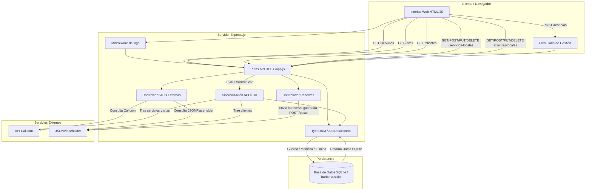

# Barbería El J- API REST, Base de Datos, Observabilidad y Seguridad

Proyecto de aplicación web para la gestión de la barbería MVP Barber Club. El sistema combina el consumo de APIs externas (Cal.com y JSONPlaceholder) con persistencia de datos local mediante **TypeORM** y **SQLite**, con un flujo CRUD completo. Incluye registro de logs, un endpoint de salud, medidas de seguridad y pruebas de integración.

---

## Tecnologías e infraestructura
- **Backend:** Node.js con Express.
- **Base de datos local:** SQLite administrada con **TypeORM**. Las tablas las crea el ORM a partir de las entidades (synchronize: true), sin SQL manual.
- **Frontend:** interfaz web en HTML5, CSS3 y JavaScript, con la API fetch para hablar con el servidor.
- **Integraciones externas:** API de Cal.com (servicios y citas) y JSONPlaceholder (clientes de prueba y envío de reservas).
- **Logs:** winston.
- **Pruebas:** Jest y Supertest.

---

## Cómo ejecutarlo
1. Instalar las librerías: `npm install`
2. Crear un archivo `.env` en la raíz con estas dos variables:
   ```
   CAL_API_KEY=tu_clave_de_cal
   CLAVE_BARBERO=la_clave_del_barbero
   ```
3. Encender el servidor: `npm start` (o `node src/app.js`)
4. Abrir http://localhost:3000

Al arrancar, el servidor copia a la base de datos los datos de las APIs (sin repetir los que ya existen).

## Cómo ejecutar las pruebas
`npm test`

Las pruebas de integración usan una base de datos en memoria, así que no tocan `barberia.sqlite`.

---

## Endpoints (API REST)

### 1. Salud del servidor
- `GET /health`: responde `{ "status": "ok", "timestamp": "..." }` para comprobar que el servidor está vivo.

### 2. Servicios externos (Reto 1)
- `GET /servicios`: lista de servicios agendables desde la API de Cal.com.
- `GET /citas`: citas programadas desde Cal.com.
- `GET /clientes`: clientes de prueba obtenidos desde JSONPlaceholder.

### 3. Persistencia y CRUD local (Reto 2)
- **CRUD de reservas (entidad Cita):**
  - `POST /reservas`: valida los datos, guarda en SQLite y envía la reserva a una API externa. Responde 201 con la reserva y su id.
  - `GET /reservas`: lista todas las reservas.
  - `GET /reservas/:id`: busca una reserva por su id (404 si no existe).
  - `PUT /reservas/:id`: modifica una reserva y la devuelve (404 si no existe). **Solo el barbero.**
  - `DELETE /reservas/:id`: elimina una reserva y confirma (404 si no existe). **Solo el barbero.**
- **Servicios locales (`/servicios-locales`):** GET es de todos; POST, PUT y DELETE son solo del barbero.
- **Clientes locales (`/clientes-locales`):** GET, POST y PUT validan los datos de entrada; DELETE es solo del barbero.
- `POST /sincronizar`: trae los datos de las APIs y los guarda en la base con el ORM. **Solo el barbero.**
- `DELETE /datos`: borra los datos locales. **Solo el barbero.**
- `POST /login-barbero`: comprueba la clave del barbero.

Las acciones del barbero exigen el encabezado `x-clave-barbero` con la clave guardada en el `.env`.

---

## Envío a una API externa
Al crear una reserva (`POST /reservas`), la aplicación la guarda en la base de datos con TypeORM y después la envía con POST a JSONPlaceholder (https://jsonplaceholder.typicode.com/posts). La respuesta incluye el estado del envío. Si la API externa falla, la reserva igual queda guardada.

## Sincronización de la API a la base de datos
El servicio `src/services/sincronizarService.js` trae los clientes (JSONPlaceholder), los servicios y las citas (Cal.com) y los guarda en la base de datos usando solo el ORM (`create` y `save`). Antes de guardar revisa si el registro ya existe, para no repetirlo. Se ejecuta al arrancar el servidor y también con `POST /sincronizar`.

---

## Observabilidad (Reto 3, parte 1)
- **Logs:** el archivo `src/logger.js` configura winston. Un middleware registra cada petición con método, ruta, código HTTP y tiempo (por ejemplo `GET /health 200 4ms`).
- **Errores:** se registran con nivel `[ERROR]` y el stacktrace completo, en la terminal y en el archivo `logs/app.log`.
- **Endpoint `/health`:** descrito arriba.

## Seguridad (Reto 3, parte 2)
| Vulnerabilidad | Riesgo | Corrección |
|---|---|---|
| Sin validación de entrada | Se guardaban nombres vacíos, teléfonos inválidos y un `id` forzado | `limpiarCliente` y `validarCliente`: solo pasan `nombre` y `telefono`, con reglas de largo y formato. Responde 400 |
| Endpoints sin autenticación | Cualquiera podía modificar reservas | `PUT /reservas/:id` exige la clave del barbero. Responde 401 |
| Errores técnicos expuestos | El stacktrace mostraba rutas internas, y el encabezado `X-Powered-By` revelaba Express | Manejador de errores con mensajes genéricos (el detalle va al log) y `app.disable('x-powered-by')` |

Además, las claves están en el archivo `.env`, que no se sube al repositorio.

## Pruebas de integración (Reto 3, parte 3)
En `tests/integracion.test.js`, con Jest y Supertest, sobre una base de datos en memoria:
1. **Create:** `POST /reservas` responde 201 y el dato queda en la base.
2. **Read:** se guarda una reserva y `GET /reservas/:id` devuelve exactamente ese dato.
3. **Delete:** se crea y se borra una reserva, y el `GET` siguiente responde 404.

En `tests/pruebas.test.js` están las pruebas del Reto 1, con servicios simulados (mocks).

---

## Inyección de dependencias
Los controladores no crean sus servicios: los reciben desde afuera. Así, en las pruebas se les pasa un servicio simulado (mock) y se prueba sin internet ni base de datos.

---

## Diagrama de flujo del sistema

