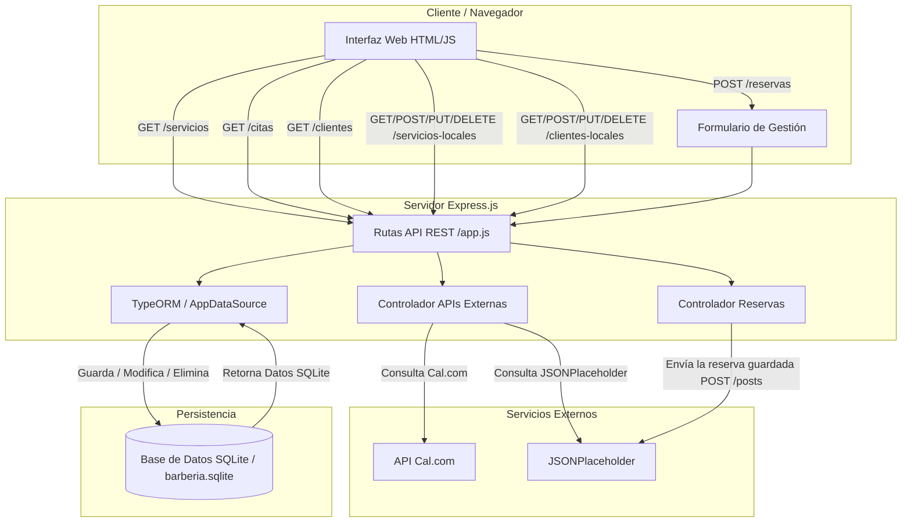

# Barber Club - API REST y Base de Datos Local

Proyecto de aplicación web para la gestión de la barbería MVP Barber Club. El sistema combina el consumo de APIs externas (Cal.com y JSONPlaceholder) con persistencia de datos local mediante **TypeORM** y **SQLite**, con un flujo CRUD completo.

---

## Tecnologías e infraestructura
- **Backend:** Node.js con Express.
- **Base de datos local:** SQLite administrada con **TypeORM**. Las tablas las crea el ORM a partir de las entidades (synchronize: true), sin SQL manual.
- **Frontend:** interfaz web en HTML5, CSS3 y JavaScript, con la API fetch para hablar con el servidor.
- **Integraciones externas:** API de Cal.com (servicios y citas) y JSONPlaceholder (clientes de prueba y envío de reservas).

---

## Cómo ejecutarlo
1. Instalar las librerías: npm install
2. Crear un archivo .env en la raíz con la clave de Cal.com: CAL_API_KEY=tu_clave
3. Encender el servidor: node src/app.js
4. Abrir http://localhost:3000

## Cómo ejecutar las pruebas
npm test

---

## Endpoints (API REST)

### 1. Servicios externos (Reto 1)
- `GET /servicios`: lista de servicios agendables desde la API de Cal.com.
- `GET /citas`: citas programadas desde Cal.com.
- `GET /clientes`: clientes de prueba obtenidos desde JSONPlaceholder.

### 2. Persistencia y CRUD local (Reto 2)
- **CRUD de reservas (entidad Cita):**
  - `POST /reservas`: valida los datos, guarda en SQLite y envía la reserva a una API externa. Responde 201 con la reserva y su id.
  - `GET /reservas`: lista todas las reservas.
  - `GET /reservas/:id`: busca una reserva por su id (404 si no existe).
  - `PUT /reservas/:id`: modifica una reserva y la devuelve (404 si no existe).
  - `DELETE /reservas/:id`: elimina una reserva y confirma (404 si no existe).
- **Servicios locales (`/servicios-locales`):** GET, POST, PUT y DELETE sobre la tabla de servicios.
- **Clientes locales (`/clientes-locales`):** GET, POST, PUT y DELETE sobre la tabla de clientes.

---

## Envío a una API externa
Al crear una reserva (`POST /reservas`), la aplicación la guarda en la base de datos con TypeORM y después la envía con POST a JSONPlaceholder (https://jsonplaceholder.typicode.com/posts). La respuesta incluye el estado del envío. Si la API externa falla, la reserva igual queda guardada.

## Inyección de dependencias
Los controladores no crean sus servicios: los reciben desde afuera. Así, en las pruebas se les pasa un servicio simulado (mock) y se prueba sin internet ni base de datos.

---

## Diagrama de flujo del sistema

